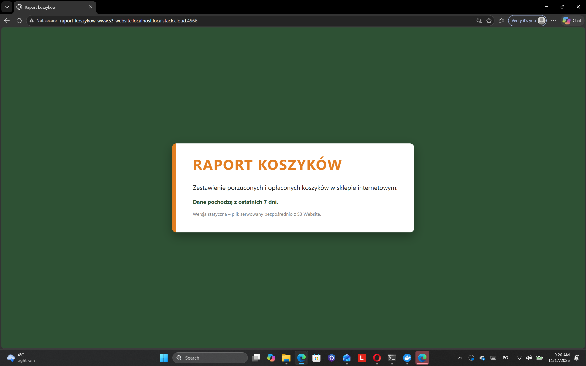
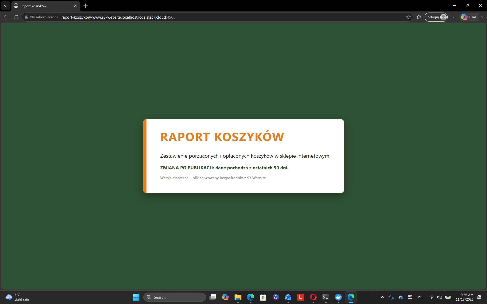
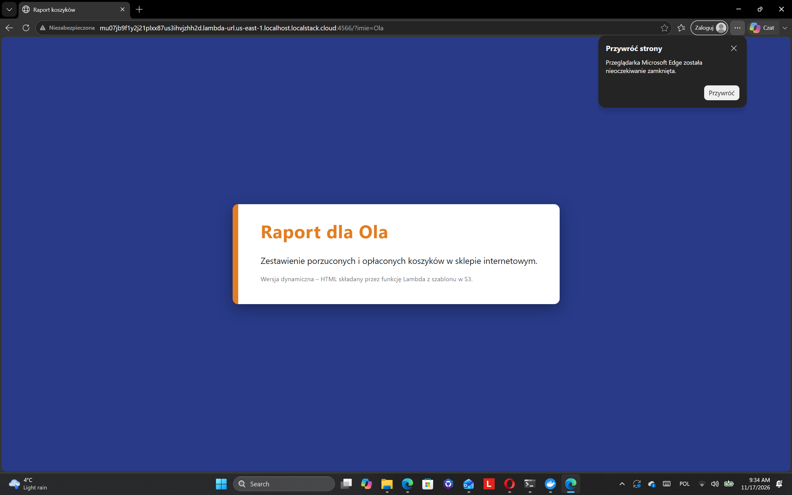
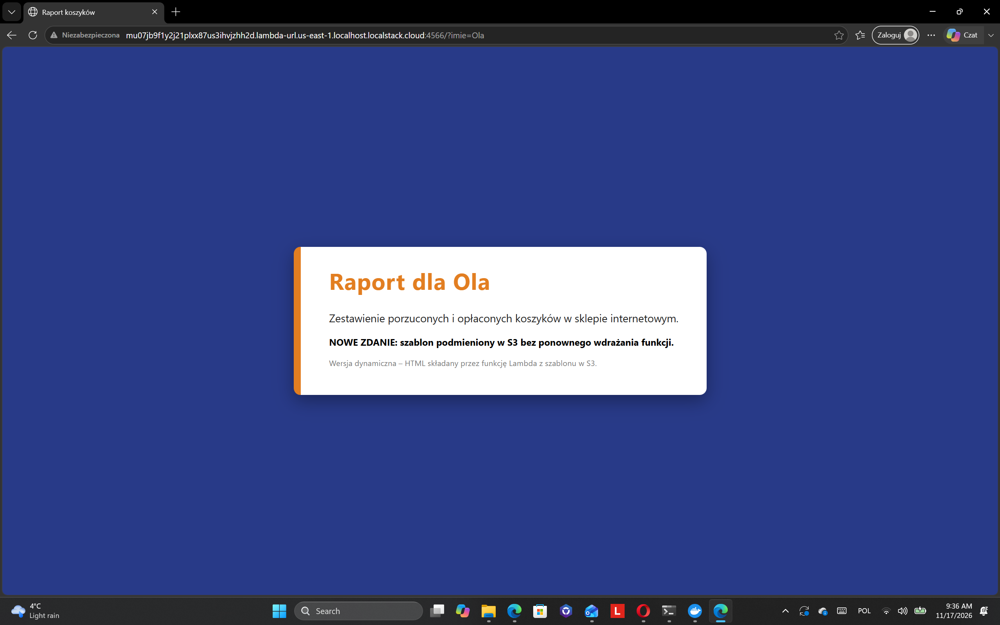
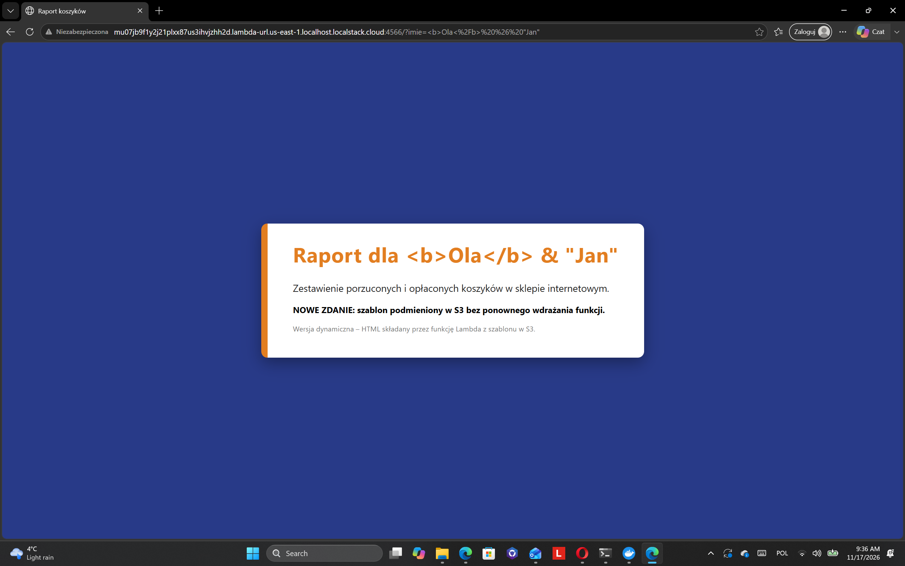
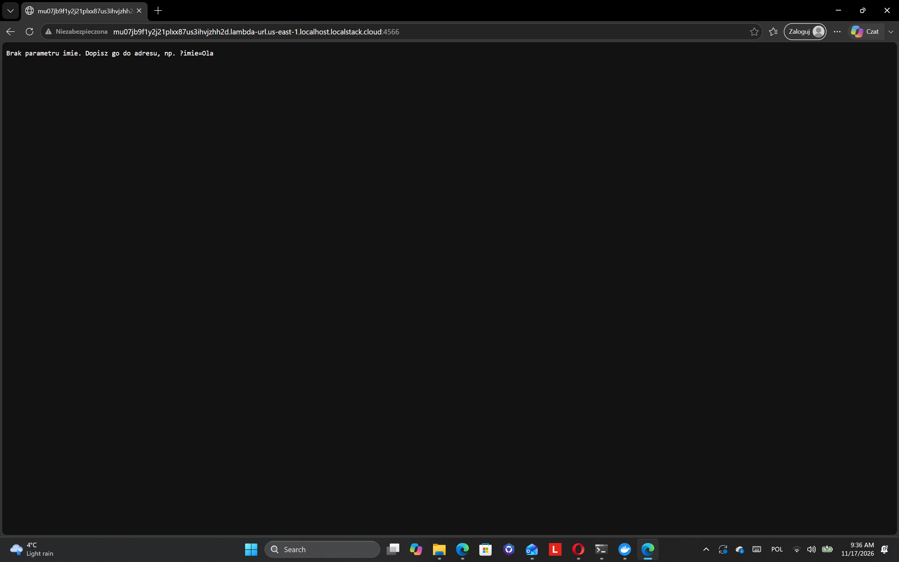

# Lab 2 – Jedna strona, dwa sposoby udostępnienia (S3 Website + Lambda Function URL)

**Autor:** Sebastian Dunowski  **Data:** 17.11.2026
**Środowisko:** Windows 11, Docker Desktop 29.9.3, LocalStack 2026.10.7 (Docker Compose), `lstk` 1.4.5, AWS CLI 2.40.2, Python 3.12 (runtime Lambdy)

Pełny zapis poleceń wykonanych w konsoli wraz z wynikami: [`polecenia-lstk.txt`](polecenia-lstk.txt).

## Zasoby

| Rodzaj | Nazwa | Uwagi |
|---|---|---|
| Bucket (strona statyczna) | `raport-koszykow-www` | hosting statyczny, dokument startowy `index.html`, publiczny odczyt przez [`www/bucket-policy.json`](../www/bucket-policy.json) |
| Bucket (szablon) | `raport-koszykow-szablony` | **domyślne** ustawienia dostępu (Block Public Access włączony, brak polityki) |
| Obiekt szablonu | `s3://raport-koszykow-szablony/template.html` | ten obiekt podmieniano bez wdrażania funkcji |
| Funkcja Lambda | `raport-koszykow-lambda` | Python 3.12, handler `handler.lambda_handler`, rola `raport-koszykow-lambda-role` |
| Function URL | `http://mu07jb9f1y2j21plxx87us3ihvjzhh2d.lambda-url.us-east-1.localhost.localstack.cloud:4566/` | `AuthType: NONE` |
| S3 Website | `http://raport-koszykow-www.s3-website.localhost.localstack.cloud:4566/` | |

## Pliki w repozytorium

```
compose.yaml              – LocalStack w Docker Compose
.env.example              – wzór pliku z tokenem (prawdziwy .env jest w .gitignore)
.gitignore
www/index.html, www/style.css, www/bucket-policy.json   – strona statyczna + polityka bucketu
lambda/handler.py         – kod funkcji (jedyny plik paczki wdrożeniowej)
lambda/template.html      – końcowa wersja szablonu (z dopisanym zdaniem)
scripts/log.sh            – pomocnik zapisujący polecenia do dowody/polecenia-lstk.txt
scripts/zrzut.ps1         – zrzut ekranu przeglądarki z paskiem adresu
dowody/02-s3-lambda.md, dowody/polecenia-lstk.txt, dowody/zrzuty/*.png
```

## 1. Środowisko

`compose.yaml` – najważniejsze elementy:

* porty wystawione **tylko lokalnie**: `127.0.0.1:4566:4566` oraz `127.0.0.1:4510-4559:4510-4559`,
* `LOCALSTACK_AUTH_TOKEN=${LOCALSTACK_AUTH_TOKEN:?…}` – obraz `localstack/localstack` wymaga tokenu; token leży w lokalnym pliku `.env`, który jest w `.gitignore`,
* montowanie `/var/run/docker.sock:/var/run/docker.sock` – **wymagane przez Lambdę**: LocalStack uruchamia każdą funkcję w osobnym kontenerze Dockera, więc potrzebuje dostępu do demona Dockera hosta.

Polecenia AWS CLI kierowane są do emulatora przez wrapper `lstk aws …` (ustawia endpoint `http://localhost.localstack.cloud:4566`).

```bash
docker compose up -d
docker compose ps        # localstack-main  Up (healthy)  127.0.0.1:4566->4566/tcp, 127.0.0.1:4510-4559->4510-4559/tcp
lstk status              # LocalStack AWS Emulator is running, Version 2026.10.7
lstk aws sts get-caller-identity
```

## 2. Wdrożenie wariantu S3 Website

```bash
lstk aws s3 mb s3://raport-koszykow-www
lstk aws s3 cp www/index.html s3://raport-koszykow-www/index.html --content-type "text/html; charset=utf-8"
lstk aws s3 cp www/style.css  s3://raport-koszykow-www/style.css  --content-type "text/css; charset=utf-8"
lstk aws s3 website s3://raport-koszykow-www --index-document index.html
lstk aws s3api delete-public-access-block --bucket raport-koszykow-www
lstk aws s3api put-bucket-policy --bucket raport-koszykow-www --policy file://www/bucket-policy.json
```

Sprawdzenie: `GET /` → `200 OK, Content-Type: text/html; charset=utf-8`, `GET /style.css` → `200, text/css; charset=utf-8`.

Zmiana jednego zdania („Dane pochodzą z ostatnich 7 dni.” → „ZMIANA PO PUBLIKACJI: dane pochodzą z ostatnich 30 dni.”) i ponowne przesłanie:

```bash
lstk aws s3 cp www/index.html s3://raport-koszykow-www/index.html --content-type "text/html; charset=utf-8"
```

**Przed zmianą** – strona z CSS (zielone tło, biała karta, pomarańczowy nagłówek wielkimi literami):



**Po zmianie** – ten sam adres, zmienione zdanie:



## 3. Wdrożenie wariantu Lambda Function URL

Szablon do osobnego bucketu z domyślnymi (prywatnymi) ustawieniami:

```bash
lstk aws s3 mb s3://raport-koszykow-szablony
lstk aws s3 cp lambda/template.html s3://raport-koszykow-szablony/template.html --content-type "text/html; charset=utf-8"
lstk aws s3api get-public-access-block --bucket raport-koszykow-szablony   # wszystkie 4 flagi = true
```

Paczka wdrożeniowa zawiera **tylko kod funkcji** (`handler.py`, 1 plik), szablon zostaje w S3:

```bash
cd lambda && powershell -Command "Compress-Archive -Path handler.py -DestinationPath function.zip -Force" && cd ..
lstk aws iam create-role --role-name raport-koszykow-lambda-role --assume-role-policy-document '{"Version":"2012-10-17","Statement":[{"Effect":"Allow","Principal":{"Service":"lambda.amazonaws.com"},"Action":"sts:AssumeRole"}]}'
lstk aws lambda create-function --function-name raport-koszykow-lambda --runtime python3.12 \
  --handler handler.lambda_handler --zip-file fileb://lambda/function.zip \
  --role arn:aws:iam::000000000000:role/raport-koszykow-lambda-role --timeout 15 \
  --environment 'Variables={TEMPLATE_BUCKET=raport-koszykow-szablony,TEMPLATE_KEY=template.html}'
lstk aws lambda wait function-active-v2 --function-name raport-koszykow-lambda
lstk aws lambda create-function-url-config --function-name raport-koszykow-lambda --auth-type NONE
```

Logika funkcji ([`lambda/handler.py`](../lambda/handler.py)):

* czyta `event["queryStringParameters"]["imie"]`; brak lub pusta wartość → **400** + podpowiedź (`text/plain; charset=utf-8`),
* przy każdym żądaniu pobiera `template.html` z S3 (`boto3`, `get_object`), zastępuje `{{IMIE}}` wartością przepuszczoną przez `html.escape()` – znaki specjalne wyświetlają się jako tekst,
* zwraca **200** z `Content-Type: text/html; charset=utf-8`.

### Zrzuty – Ola i Jan

`?imie=Ola` (pierwsza wersja szablonu):



Następnie w szablonie dopisano zdanie **„NOWE ZDANIE: szablon podmieniony w S3 bez ponownego wdrażania funkcji.”** i przesłano ponownie **tylko obiekt `s3://raport-koszykow-szablony/template.html`** (funkcja nie była wdrażana ponownie – `LastModified` funkcji `2026-11-17T07:27:27`, obiekt szablonu `2026-11-17T07:34:29`):

```bash
lstk aws s3 cp lambda/template.html s3://raport-koszykow-szablony/template.html --content-type "text/html; charset=utf-8"
```

`?imie=Jan` po odświeżeniu – widać dodane zdanie:


`?imie=Ola` po odświeżeniu – również z nowym zdaniem:



Znaki specjalne (`?imie=<b>Ola</b> & "Jan"`) wyświetlane jako tekst, a nie interpretowane jako HTML:



## 4. Odpowiedzi HTTP i źródło HTML

**200 + Content-Type** (Ola, Jan):

```
$ curl -s -i '…lambda-url…:4566/?imie=Ola' | grep -iE '^HTTP|^content-type|<h1>'
HTTP/1.1 200 OK
Content-Type: text/html; charset=utf-8
    <h1>Raport dla Ola</h1>

$ curl -s -i '…lambda-url…:4566/?imie=Jan' | grep -iE '^HTTP|^content-type|<h1>'
HTTP/1.1 200 OK
Content-Type: text/html; charset=utf-8
    <h1>Raport dla Jan</h1>
```

**400 z komunikatem** (brak parametru oraz pusty parametr):

```
$ curl -s -i 'http://mu07jb9f1y2j21plxx87us3ihvjzhh2d.lambda-url.us-east-1.localhost.localstack.cloud:4566/'
HTTP/1.1 400 BAD REQUEST
Content-Type: text/plain; charset=utf-8
Content-Length: 55

Brak parametru imie. Dopisz go do adresu, np. ?imie=Ola

$ curl -s -i '…lambda-url…:4566/?imie='
HTTP/1.1 400 BAD REQUEST
Content-Type: text/plain; charset=utf-8

Brak parametru imie. Dopisz go do adresu, np. ?imie=Ola
```



**Escapowanie:**

```
$ curl -s '…/?imie=%3Cb%3EOla%3C%2Fb%3E%20%26%20%22Jan%22' | grep '<h1>'
    <h1>Raport dla &lt;b&gt;Ola&lt;/b&gt; &amp; &quot;Jan&quot;</h1>
```

**Obiekt odczytany z S3 po podmianie – nadal zawiera `{{IMIE}}`** (funkcja nie nadpisuje szablonu, podstawia imię tylko w odpowiedzi):

```
$ lstk aws s3 cp s3://raport-koszykow-szablony/template.html - | grep -nE 'IMIE|NOWE'
20:    <h1>Raport dla {{IMIE}}</h1>
22:    <p class="nowe"><b>NOWE ZDANIE: szablon podmieniony w S3 bez ponownego wdrażania funkcji.</b></p>
```

## 5. Wniosek

**Kto dostarcza HTML?**
W wariancie **S3 Website** HTML (i CSS) dostarcza bezpośrednio usługa S3 – przeglądarka dostaje dokładnie ten plik, który został przesłany do bucketu; nie wykonuje się żaden kod. W wariancie **Lambda Function URL** HTML dostarcza **funkcja Lambda**: przy każdym żądaniu pobiera szablon z prywatnego bucketu, podstawia imię i sama buduje odpowiedź HTTP (status, nagłówki, treść). S3 jest tu tylko magazynem szablonu, niedostępnym publicznie.

**Kiedy wystarczy strona statyczna?**
Gdy treść jest taka sama dla każdego odbiorcy i nie zależy od parametrów żądania (strona informacyjna, dokumentacja, wizytówka, raport generowany raz i publikowany jako plik). Jest wtedy prościej, taniej i szybciej – brak kodu do utrzymania, brak uruchamiania funkcji, łatwe cache’owanie (np. CDN). Gdy potrzebna jest walidacja wejścia, personalizacja albo kody błędów (jak 400 dla braku `imie`), potrzebny jest kod po stronie serwera – tu Lambda.

**Po co trzymać szablon osobno od kodu funkcji?**
Rozdziela wygląd od logiki: treść i wygląd strony można zmienić, przesyłając nowy `template.html` do S3, **bez ponownego budowania i wdrażania funkcji** – co pokazano w ćwiczeniu (nowe zdanie pojawiło się po samym odświeżeniu strony, `LastModified` funkcji się nie zmienił). Paczka wdrożeniowa jest mała i zawiera tylko kod, szablon może edytować osoba nietechniczna, łatwo mieć różne szablony (np. per środowisko przez zmienną `TEMPLATE_KEY`), a bucket z szablonem może zostać prywatny, bo czyta go tylko funkcja.
